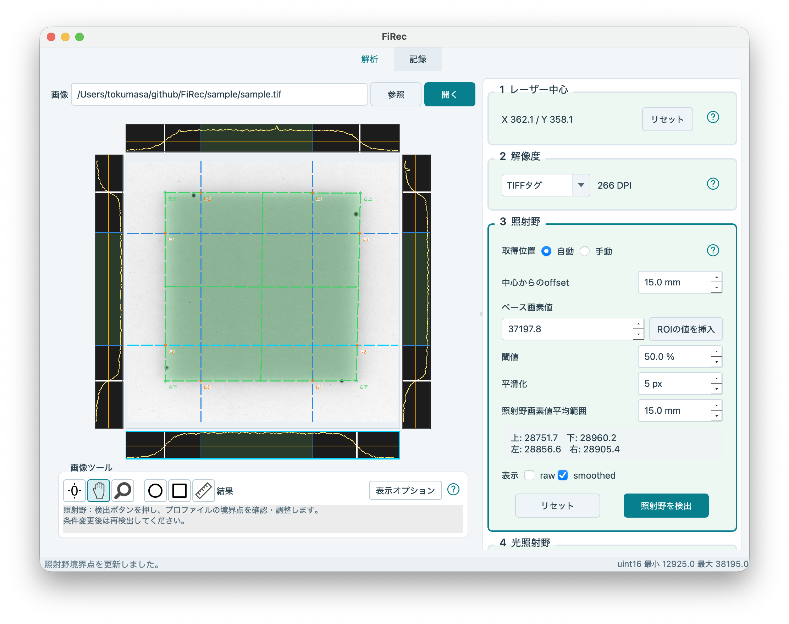
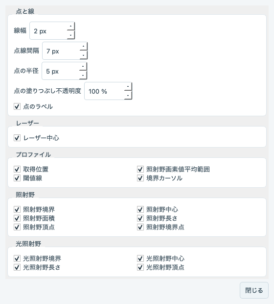
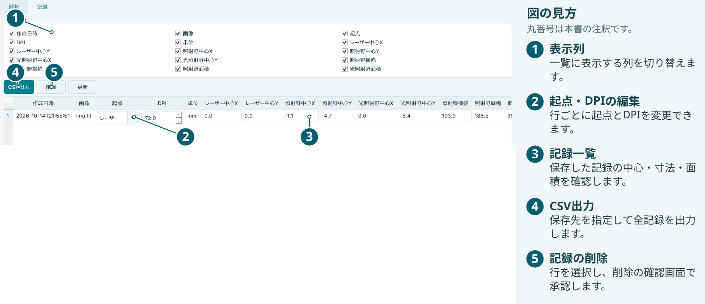

# FiRec 操作マニュアル

フィルムスキャンTIFFによる照射野・光照射野の比較と記録

更新：2026年11月5日

## 1. 基本の流れ

FiRecは、TIFF画像の暗い照射野をプロファイルから検出し、画像上で指定した光照射野と中心・寸法・面積を比較するソフトです。「解析」タブで画像を設定・解析し、「記録」タブで保存済みの結果を閲覧・編集・出力します。

1. 「参照」でTIFF画像を開きます。
2. 「1 レーザー中心」を選び、画像上の基準位置をクリックします。
3. 「2 解像度」で画像の縮尺を設定します。
4. 「3 照射野」でプロファイル位置と検出条件を設定し、「照射野を検出」を押します。
5. 波形と境界点を確認し、必要に応じて調整します。
6. 「4 光照射野」を選び、辺・頂点を画像の光照射野境界へ合わせます。
7. 「5 結果」で起点と数値を確認し、「保存」を押します。

解析枠のタイトルや余白をクリックすると、操作する枠を選べます。「3 照射野」の枠をクリックすると、現在の設定で照射野を検出します。Ctrl＋PageDown／Ctrl＋PageUpで次／前の枠へ移動し、Tab／Shift＋Tabで入力欄間を移動できます。

| 枠の表示 | 意味 |
| --- | --- |
| 緑の背景 | 設定または結果処理が完了 |
| 淡い黄の背景 | 設定または検出が必要 |
| オレンジの背景 | 現在の条件で再解析が必要 |
| 青緑の輪郭 | 操作中の解析枠 |

各枠の「?」にカーソルを重ねると、その枠のヘルプを表示します。画像下の操作説明欄には、選択中の解析枠の手順が表示されます。右側の解析欄は、数値入力欄や選択欄の上からもスクロールできます。数値は直接入力するか上下ボタンで調整し、選択項目は一覧を開いて指定します。

### 解析画面の例

サンプル画像を72 DPI、offset 13 mmで解析した画面です。

## 2. 画像を開く・画像ツールを使う

「参照」でTIFFを選ぶと画像が開きます。パスを直接入力し、「開く」を押すかEnterでも開けます。前回のパスは次回起動時に復元します。画面下部に画素の種類と最小・最大画素値を表示します。

画像の周囲に、解析で使う上・下・左・右のプロファイルを表示します。画像の拡大・移動に合わせて、グラフの表示範囲も変わります。

### 表示位置と倍率

| 操作 | 動作 |
| --- | --- |
| 全体表示アイコン、または画像上のダブルクリック | 画像全体が収まる表示位置と倍率へ戻します。 |
| 移動ツールでドラッグ、またはShift＋ドラッグ | 画像の表示位置を移動します。画像の上下左右に余白があり、画像全体を表示した状態でも移動できます。 |
| ズームツールでドラッグ、またはCtrl＋ドラッグ | 上へドラッグすると拡大、下へドラッグすると縮小します。ドラッグ開始位置が基準です。 |
| 画像上でスクロール | 上にスクロールすると拡大、下にスクロールすると縮小します。カーソル位置が基準です。 |

ShiftまたはCtrlを押している間は、対応するツールボタンとカーソルが切り替わり、キーを離すと元のツールに戻ります。両方を押した場合はズームを優先します。画像ツール枠の右上の「?」にカーソルを重ねると、詳しい表示操作を確認できます。

### ROIと定規

| ツール | 操作 |
| --- | --- |
| 円 | 中心からドラッグして円を描き、円内の平均画素値を測定します。中心や円周の点をドラッグして調整できます。 |
| 矩形 | 対角の角へドラッグして矩形を描き、矩形内の平均画素値を測定します。 |
| 定規 | 2点をクリックして距離を測定します。端点をドラッグして調整できます。 |

測定値はツール横の「結果」に表示します。定規の単位は校正済みならmm、未校正ならpxです。選択中のツールボタンを再度押すと、解析枠の操作へ戻ります。

## 3. レーザー中心・解像度を設定する

### レーザー中心

「1 レーザー中心」を選び、十字カーソルで画像上のレーザーの印や基準位置をクリックします。指定した位置に中心と水平・垂直の青い点線が現れます。水平線を上下、垂直線を左右にドラッグして微調整します。選択中の線は水色で表示されます。

左・下のグラフのカーソルでも中心を調整できます。設定したX・Y座標は枠内に表示します。「リセット」を押すと中心の指定を解除し、画像上をクリックして指定し直せます。

### 解像度

「2 解像度」の一覧から校正方法を選びます。選択方法と入力値は次回起動時に復元します。

| 方法 | 設定 |
| --- | --- |
| DPI入力 | 1インチあたりの画素数を正の数で入力します。 |
| TIFFタグ | TIFFの解像度タグを読み取り、DPIを表示します。 |
| mm/px入力 | 1画素あたりの長さをmmで入力します。換算したDPIを下の行に表示します。 |
| 未校正 | 画素を単位として評価します。 |

mm/pxは25.4をDPIで割って求めます。300 DPIは約0.08467 mm/pxです。TIFFタグを使う場合は、利用できるX・Y方向の解像度をDPIへ換算し、その平均を両方向に適用します。

解像度は中心座標・寸法・面積・定規の換算と、照射野のoffsetおよび平均範囲の指定に使います。校正済みの場合は距離をmm、未校正の場合はpxで指定します。

## 4. 照射野を検出する

「3 照射野」で、上・下の水平線2本と左・右の垂直線2本を配置します。各線が照射野内部と両側の境界を横切るように設定します。1本につき2点、合計8点の境界位置から照射野の輪郭を求めます。

| 取得位置 | 操作 |
| --- | --- |
| 自動 | 「中心からのoffset」で、レーザー中心から上下左右の線までの距離を指定します。 |
| 手動 | 画像上の線をドラッグして個別に配置します。「配置を戻す」で自動配置と同じ位置に揃えます。 |

### 検出条件

| 項目 | 意味 |
| --- | --- |
| ベース画素値 | 未照射部分の基準画素値です。数値入力またはROIの測定値で指定します。 |
| 閾値 | ベース画素値から照射野の平均画素値までの変化に対する割合です。50%は2つの値の中間に相当します。 |
| 平滑化 | 波形を平滑化する範囲を画素数で指定します。 |
| 照射野画素値平均範囲 | 水平線ではレーザー中心のX座標、垂直線ではY座標から、両側に指定距離を取ります。その範囲の平滑化後の画素値を平均します。 |

ROIからベース画素値を設定するには、円または矩形ツールで未照射部分にROIを配置し、平均画素値を確認して「ROIの値を挿入」を押します。測定した平均画素値がベース画素値の入力欄に入ります。

平均範囲の設定の下には、上・下・左・右のプロファイルごとに算出した照射野画素値を表示します。検出条件を設定したら「照射野を検出」を押します。レーザー中心・解像度・検出条件・取得位置を変更したときも、現在の条件で検出します。

照射野欄の「リセット」は、照射野の境界点と光照射野の設定を初期化します。

### 波形と境界を調整する

画像周囲のグラフをクリックすると、対応するプロファイルを選択します。暗い照射野ほど波形が高くなるよう、画素値を反転して表示します。

| 表示 | 意味 |
| --- | --- |
| 画像上の青い点線 | プロファイルの取得位置。選択中の線は水色です。 |
| グラフ上の青い線 | 直交する2本のプロファイルの取得位置。 |
| 水色の波形（raw） | 元の画素値を反転した波形。 |
| 淡い黄色の波形（smoothed） | 平滑化した波形。 |
| オレンジの線 | 境界検出の閾値。 |
| 薄い緑の帯 | 照射野画素値を平均する範囲。 |
| 白い境界カーソル | 境界位置。操作中はオレンジになります。 |
| 画像上のオレンジの点 | 境界カーソルに対応する位置。 |
| 画像上の緑の点線 | 8点から作る照射野境界。 |

グラフ上の境界カーソルをドラッグすると、対応する画像上の境界点と照射野の輪郭が更新されます。raw／smoothedのチェックで、確認する波形を切り替えられます。

## 5. 光照射野と表示を調整する

「4 光照射野」を選び、画像上のピンクの点線を光照射野の印や境界に合わせます。辺または頂点をドラッグして調整します。選択した辺は赤色になります。画像にフォーカスを置き、矢印キーで1 px、Shift＋矢印キーで10 pxずつ調整できます。

光照射野の初期位置と「リセット」の戻り先は、照射野が設定済みならその境界、照射野の検出前なら画像中央の矩形です。

### 表示オプション

画像ツール行の右側の「表示オプション」を押すと、設定が別ウィンドウで開きます。設定は画像とグラフへ反映され、次回起動時に復元します。

| 分類 | 設定できる表示 |
| --- | --- |
| 点と線 | 線幅、点線間隔、点の半径、点の塗りつぶし不透明度、点のラベル |
| レーザー | レーザー中心 |
| プロファイル | 取得位置、照射野画素値平均範囲、閾値線、境界カーソル |
| 照射野 | 境界、中心、面積、長さ、頂点、境界点 |
| 光照射野 | 境界、中心、長さ、頂点 |

## 6. 結果を確認・保存する

画像・レーザー中心・解像度・照射野・光照射野の設定が揃うと、「5 結果」に数値を自動表示します。入力が必要な項目は、結果欄の案内に表示します。

結果欄の「起点」で、レーザー中心・照射野中心・光照射野中心から座標の基準を選びます。各中心座標は起点からの相対座標です。画像の右がXの正方向、下がYの正方向です。

| 項目 | 意味 |
| --- | --- |
| 中心 | 辺の中点を結ぶ線の交点。 |
| 面積長X | 左右の辺の中点間の距離。記録の照射野横幅に相当します。 |
| 面積長Y | 上下の辺の中点間の距離。記録の照射野縦幅に相当します。 |
| 平均辺長 | 4辺の長さの平均。 |

校正済みの場合、長さと面積はmmとmm²で表示し、未校正の場合はpxとpx²で表示します。起点と結果を確認して「保存」を押すと、「記録」タブに1件追加します。

## 7. 記録の閲覧・編集・CSV出力

「記録」タブには、保存済みの結果が保存順に並びます。「更新」で再読み込みします。「表示列」のチェックで一覧に表示する列を選びます。表示列の設定は次回起動時に復元します。

### 起点とDPIの編集

各行の起点とDPIを変更すると、その記録の換算結果が更新されます。DPIが0ならpx・px²、正の値ならmm・mm²で表示します。

### CSV出力と削除

「CSV出力」で保存先を指定すると、全記録・全列をUTF-8のCSVへ出力します。主な列は日時・画像名・起点・DPI・単位・各中心X/Y・照射野の横幅と縦幅・両照射野の面積です。

記録を削除するには、一覧で対象の行を選択して「削除」を押し、確認画面で承認します。複数行をまとめて選べます。

### 保存先とバックアップ

記録はアプリを実行した作業フォルダの `firec.sqlite` に保存します。バックアップするには、アプリを終了してこのファイルをコピーします。
