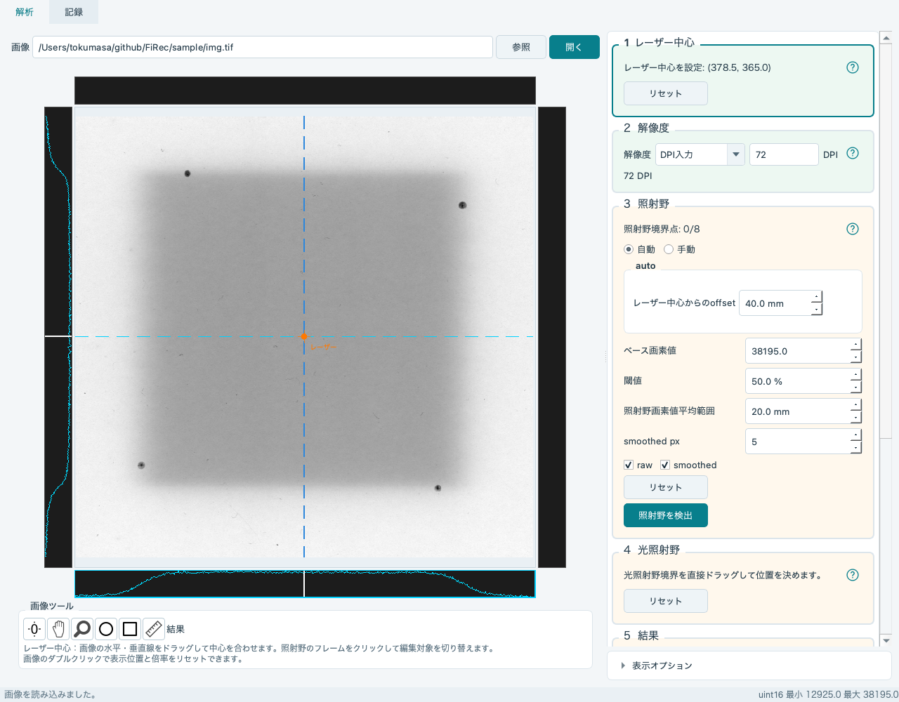
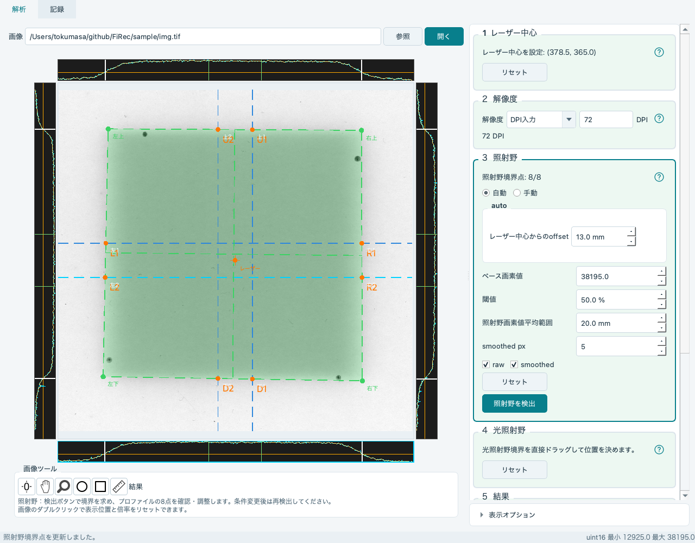
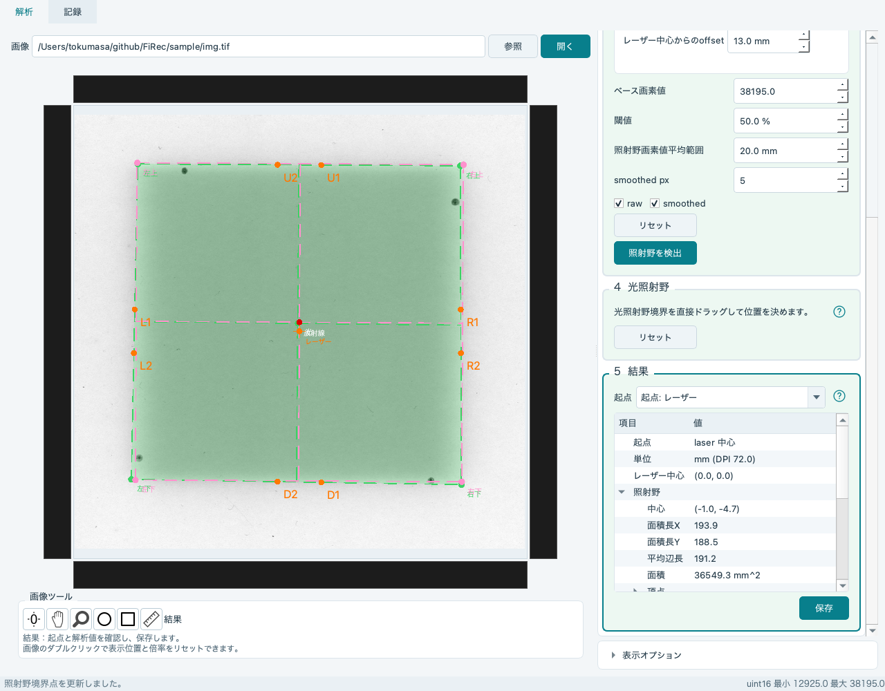
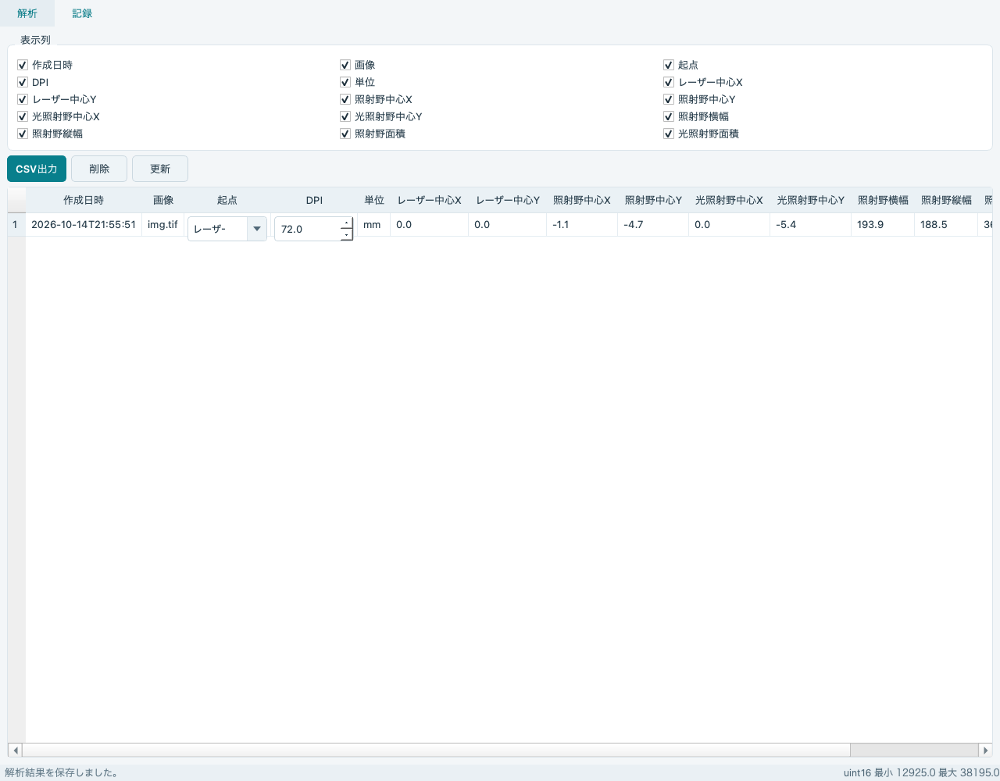

# FiRec 操作マニュアル

フィルムスキャンTIFFによる照射野・光照射野の比較と記録

更新：2026年10月14日

## 1. はじめに・基本の流れ

FiRecは、TIFF画像の暗い照射野をプロファイルから検出し、画像上で指定した光照射野と中心・寸法・面積を比較するソフトです。

### 簡易操作解説

1. FiRecを起動し、「参照」でTIFF画像を開きます。
2. 「1 レーザー中心」の枠をクリックし、水平・垂直線を基準位置へ合わせます。
3. 「2 解像度」で、今回の画像の縮尺を指定します。
4. 「3 照射野」でプロファイル位置と検出条件を設定し、「照射野を検出」を押します。
5. 波形と8個の境界位置を確認・調整します。
6. 「4 光照射野」の枠をクリックし、辺・頂点を画像の光照射野境界へ合わせます。
7. 自動で表示される「5 結果」を確認し、「保存」を押します。

本書の画面は付属サンプル画像を用いた操作例です。解像度・プロファイル位置などの値は、実際の画像に合わせて設定してください。検出境界と画像の縮尺を確認してから記録します。

<!-- pagebreak -->

## 2. 画面の見方・編集する枠を選ぶ

上部に「解析」「記録」の2つのタブがあります。「解析」では画像とプロファイル、右側に5つの解析枠を表示します。「記録」では保存済みの一覧を閲覧・編集・出力します。

| 枠 | 操作 |
| --- | --- |
| 1 レーザー中心 | 基準点を画像の水平・垂直線で指定 |
| 2 解像度 | DPI・TIFFタグ・mm/px・未校正を選択 |
| 3 照射野 | 4本のプロファイルから境界を検出・調整 |
| 4 光照射野 | 画像上の辺・頂点で境界を指定 |
| 5 結果 | 起点を選び、処理結果を確認・保存 |

枠の余白・タイトル・説明ラベルをクリックすると、その枠を編集対象にします。移動しても境界・カーソル・設定は消えません。入力順は自由ですが、結果の処理には画像・レーザー中心・有効な解像度設定・現在の条件で検出した照射野・光照射野が必要です。

| 枠の表示 | 意味 |
| --- | --- |
| 緑の背景 | 必要な設定または結果処理が成立 |
| 淡い黄の背景 | 必要な設定・検出が未完了 |
| オレンジの背景 | 条件変更により再解析が必要 |
| 青緑の輪郭 | 現在選択している編集対象 |

状態は背景色で示します。選択時に枠の並びやサイズは変わりません。右側の枠が見切れる場合は解析欄をスクロールします。画像と解析欄の境界を左右にドラッグすると幅を調整できます。

Ctrl+PageDown／Ctrl+PageUpで次／前の枠を選べます。Tab／Shift+Tabは通常の入力欄間の移動です。枠の選択だけでは検出・保存は行いません。

各枠の「？」に約1秒マウスを合わせるかクリックすると、線の色や操作説明を表示します。

<!-- pagebreak -->

## 3. 画像を開く・画像ツールを使う

「参照」でTIFFを選ぶと、そのまま読み込みます。パスを直接入力して「開く」またはEnterでも開けます。前回のパスは次回起動時に復元します。読み込み後、画面下部に画素の種類と最小・最大画素値を表示します。

画像は正方形の表示領域に収まるよう表示され、周囲に上・下・左・右のプロファイルがあります。拡大・移動に合わせて、波形に表示する範囲も変わります。

### 画像下のツール

左から「全体表示」「移動」「ズーム」「円」「矩形」「定規」の順です。使い方はツール枠内にも表示します。

| ツール・操作 | 動作 |
| --- | --- |
| 左端の全体表示アイコン／画像をダブルクリック | 表示位置・倍率をリセット。解析内容は保持 |
| 手のアイコン→ドラッグ | 表示位置を移動 |
| 虫眼鏡→上下にドラッグ | 倍率を調整 |
| 円→中心からドラッグ | 円内の平均画素値を測定。中心・円周の点で位置・大きさを調整 |
| 矩形→対角の角へドラッグ | 矩形内の平均画素値を測定 |
| 定規→2点をクリック | 距離を測定。端点をドラッグで調整 |

同じツールを再度押すと解析操作へ戻ります。ツール切替時は測定用の円・矩形・定規の状態が消えます。値はツール横の「結果」に表示します。定規は校正済みならmm、未校正ならpxです。

円・矩形の平均画素値は、照射野検出の「ベース画素値」を決める参考になります。値は自動転記されないため、必要な値を入力してください。

<!-- pagebreak -->

## 4. レーザー中心・解像度を設定する

### レーザー中心

画像を開くと、画像中央にレーザー中心を設定します。「1 レーザー中心」を選び、水平・垂直の青い点線をドラッグして、レーザーの印や基準位置へ合わせます。交点がレーザー中心です。選択中の線は水色になります。

左・下のグラフのカーソルでも中心を調整できます。「リセット」で画像中央へ戻します。レーザー中心を変更した後は、照射野を再検出してください。

### 解像度

「2 解像度」で縮尺を選びます。初回はDPI入力の72 DPIです。選択方法と入力値は次回起動時にも保持します。初期値が今回のスキャン条件に合うとは限らないため、必ず確認してください。

| 方法 | 設定と単位 |
| --- | --- |
| DPI入力 | 1インチあたりの画素数を入力。正の有限値が必要 |
| TIFFタグ | 画像の解像度タグを使用。使用できるタグがない場合は別の方法を選択 |
| mm/px入力 | 1画素あたりの長さをmmで入力。正の有限値が必要 |
| 未校正 | px単位で評価・保存 |

**mm/px＝25.4÷DPI**です。300 DPIは約0.08467 mm/pxです。FiRecのTIFFタグは、利用できるX/Y解像度を換算して平均した1つのDPIを両方向に使用します。X/Y別々の縮尺は適用しません。

解像度は中心座標・寸法・面積・定規だけでなく、プロファイルの平均範囲と自動配置のoffsetにも使用します。未校正では平均範囲・offsetもpxです。解像度を変更した後は、各値の単位を確認し、照射野を再検出してください。

定規は距離測定用です。既知の長さを入力して定規から解像度を設定する操作はありません。

<!-- pagebreak -->

## 5. 照射野を検出する

「3 照射野」で、上下に2本の水平線、左右に2本の垂直線を配置します。各線で2個ずつ、合計8個の境界位置を求めます。

| 配置方法 | 操作 |
| --- | --- |
| 自動 | 「レーザー中心からのoffset」で4本を中心から同じ距離へ配置 |
| 手動 | 画像の線を直接ドラッグして個別に配置 |

照射野内部の平坦な領域と両側の境界を横切る位置を選びます。手動欄の「リセット」は、4本を自動配置位置へ戻しますが、手動モードのままです。

### 検出条件

| 項目 | 意味 |
| --- | --- |
| ベース画素値 | 未照射フィルム・照射野外の画素値。円・矩形測定を参考に入力 |
| 閾値 | ベース画素値と照射野の平均画素値の間の割合。初期50% |
| 照射野画素値平均範囲 | プロファイル中央から両側の指定距離内を平均。校正済みはmm、未校正はpx |
| smoothed px | 波形の平滑化に用いる画素数。初期5 |

設定したら「照射野を検出」を押します。条件調整時に波形や境界プレビューが更新される場合もありますが、保存できる解析結果にするには検出ボタンを押してください。レーザー中心・解像度・検出条件・プロファイル配置の変更後も再検出が必要です。

検出しても、すでに調整した光照射野は保持します。照射野欄の「リセット」は境界点と光照射野を初期化します。手動配置欄のリセット、画像ツールの全体表示とは対象が異なります。

サンプル画像を72 DPI・offset 13 mmで検出した例です。この値を実画像の標準値として使用しないでください。

<!-- pagebreak -->

## 6. 波形・8個の境界位置を確認する

画像周囲のグラフをクリックすると、対応するプロファイルを選びます。元の画素値を反転して表示するため、暗い照射野ほど波形が高くなります。

| 表示 | 意味 |
| --- | --- |
| 画像上の青い点線 | プロファイルを取る位置。選択中は水色 |
| 水色の波形（raw） | 元の画素値を反転した波形 |
| 淡い黄色の波形（smoothed） | 平滑化後の波形 |
| オレンジの線 | 境界検出の閾値 |
| 2本の緑の線 | 照射野の平均画素値を計算する範囲 |
| 白い境界カーソル | 境界位置。操作中はオレンジ |
| 画像上のオレンジの点 | 境界カーソルに対応する位置 |
| 画像上の緑の点線 | 8点から作る照射野境界 |

4方向の波形を確認し、白いカーソルをドラッグして境界位置を調整します。画像の境界点と緑の輪郭も確認してください。上下・左右それぞれの2点が意図した領域の境界にあることを確認します。

raw／smoothedのチェックは表示切替で、解析条件を変えません。検出できない線があれば、線の位置、ベース画素値、閾値、平均範囲、平滑化を見直し、再検出します。手動調整済みのカーソルは自動更新で保持されるため、再検出後も8点を確認してください。

<!-- pagebreak -->

## 7. 光照射野を合わせる・表示を調整する

「4 光照射野」の枠をクリックします。照射野が設定済みなら、その境界を初期値にします。照射野より先に選んだ場合は、画像中央の矩形を初期値にします。

光照射野はピンクの点線です。辺や頂点をドラッグして、光照射野の印・境界へ合わせます。選択した辺は赤色です。細かく調整する場合は、対象を選択して画像にフォーカスを置き、矢印キーを使います。通常1px、Shift併用で10px単位です。

光照射野の「リセット」は、照射野があればその境界へ、なければ画像中央の矩形へ戻します。照射野を再検出しても、光照射野の調整内容は上書きしません。

### 表示オプション

解析欄下部の「表示オプション」を開くと、全表示設定をまとめて表示します。内部は「点と線」「レーザー」「照射野」「光照射野」に分類しています。

- 線幅・点線間隔・点の半径・塗りつぶし不透明度・点のラベルを調整できます。
- 各中心・境界・面積・長さ・頂点・照射野境界点の表示を切り替えられます。
- 閉じても選択内容は保持され、次回起動時にも復元します。

表示・非表示や線の太さは解析結果の数値を変えません。見づらい場合は不要な表示を一時的に消してください。

<!-- pagebreak -->

## 8. 自動処理された結果を確認・保存する

必要な入力が揃うと、「5 結果」に自動で結果を表示します。結果確認のための別ボタンはありません。入力不足・無効な解像度・再検出が必要な状態では案内を表示し、結果一覧を消して保存を停止します。

### 起点と数値

起点は「レーザー」「照射野」「光照射野」から選べます。各中心座標は選んだ中心からの相対座標です。画像では右がXの正、下がYの正です。

結果には使用単位・レーザー中心・両照射野の中心、辺長、面積などを表示します。校正済みはmmとmm²、未校正はpxとpx²です。緑は照射野、ピンクは光照射野、オレンジはレーザー中心です。結果表示時の光照射野中心点は赤色です。

「面積長X」は左右の辺の中点間距離、「面積長Y」は上下の辺の中点間距離です。「平均辺長」は4辺の長さの平均です。記録の「照射野横幅」「照射野縦幅」は面積長X／Yを使用します。傾いた輪郭では、画像のX/Y方向に囲った長方形の幅・高さとは異なります。

### 保存

画像・解像度・8個の照射野境界点・光照射野・起点を確認して「保存」を押します。「記録」タブに追加されます。保存を繰り返すと別の記録を追加します。

条件変更後に枠がオレンジになったら、「照射野を検出」で再解析します。枠の移動だけでは再検出されません。光照射野や起点だけの変更は結果へ自動反映します。

保存するのは日時・画像名・起点・DPIと、各中心・寸法・面積の元となる画素単位の値です。元TIFFや測定用図形は記録DBへ保存しません。

<!-- pagebreak -->

## 9. 記録の閲覧・編集・CSV出力

「更新」は保存済み記録を再読み込みします。一覧は解析日時順です。「表示列」のチェックで必要な列だけ表示でき、次回起動時にも保持します。

### 起点とDPIの編集

各行の起点とDPIを変更すると、その記録の換算結果を更新します。DPIが0なら未校正のpx表示、正のDPIならmm表示です。面積は縮尺の2乗で換算します。起点だけの変更は保存済みDPIを保持します。

これは保存済み画素値の換算編集です。境界を元画像から再検出する操作ではなく、記録から解析画面へ境界を再開する機能もありません。

### CSV出力と削除

「CSV出力」で保存先を指定すると、全記録をUTF-8のCSVへ出力します。画面で非表示にした列も出力対象です。主な列は日時・画像名・起点・DPI・単位・各中心X/Y・照射野の横幅と縦幅・両照射野の面積です。

行を選んで「削除」を押し、確認画面で承認すると記録を削除します。複数行の選択もできます。元TIFFは削除しません。

<!-- pagebreak -->

## 10. 保存先・バックアップ・困ったとき

### 保存先と設定

記録DBは、アプリを実行した作業フォルダの **firec.sqlite** です。FiRec.exeと同じ場所になるとは限らないため、起動方法に応じて作業フォルダを確認してください。CSVは出力操作で指定した場所へ保存します。

画像パス・解像度・検出条件・表示設定はOSのユーザー設定領域に保存します。Windowsでは通常ユーザーのレジストリ、macOSではユーザーの設定ファイルです。DBの移植とユーザー設定の移植は別です。

アプリを終了してfirec.sqliteをコピーすると記録をバックアップできます。再解析に備えて元TIFFも別途保管してください。CSVは閲覧・集計用で、FiRecへの復元入力形式ではありません。

### 主な症状と対処

| 症状 | 確認すること |
| --- | --- |
| 画像が開かない | TIFF形式、パス、ファイルの破損 |
| レーザー線・光照射野を動かせない | 編集したい枠を選び、選択中ツールを再クリックして解析操作へ戻す |
| TIFFタグを使用できない | DPI入力・mm/px入力・未校正から今回に適した方法を選ぶ |
| 境界が8点揃わない | 4本の線が照射野内部と両側の境界を通るか確認し、条件を見直す |
| 境界が意図と違う | 波形の閾値・平均範囲を確認し、カーソルで調整 |
| 結果が消えた・枠がオレンジ | 上流条件を確認し、照射野を再検出 |
| 保存ボタンを押せない | 結果欄の入力不足・校正エラー・再検出の案内 |
| mmとpxが意図と違う | 解像度の方法とDPIを確認。記録DPIは解析画面とは独立 |
| 保存後の寸法が少し違う | 元の画素値は小数1桁で保存するため換算後に丸め差が生じる場合がある |
| 記録が見つからない | 作業フォルダとfirec.sqliteの位置 |

配布版は同梱ファイルを含むアプリ一式を保管して起動します。Python環境ではプロジェクトのREADMEに従って起動できます。
